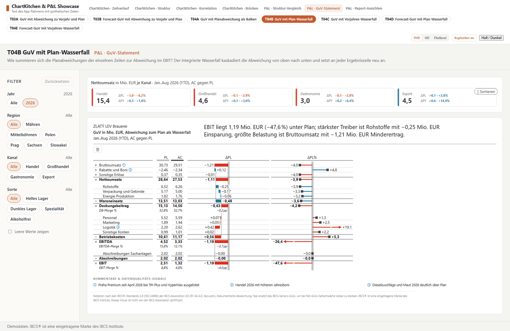
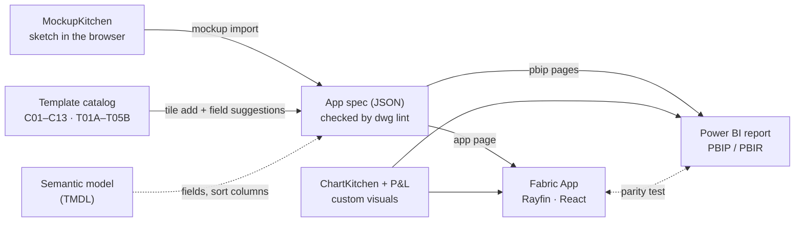
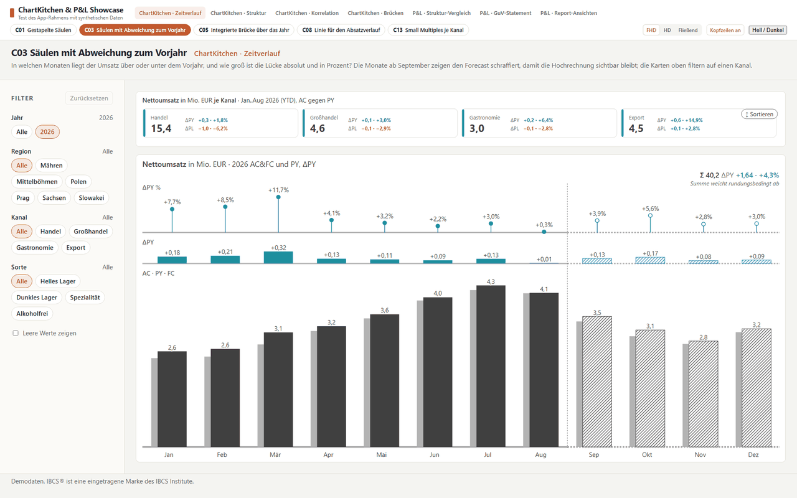
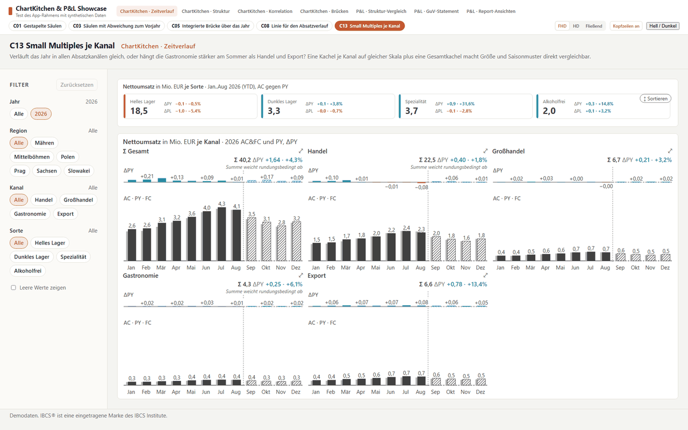
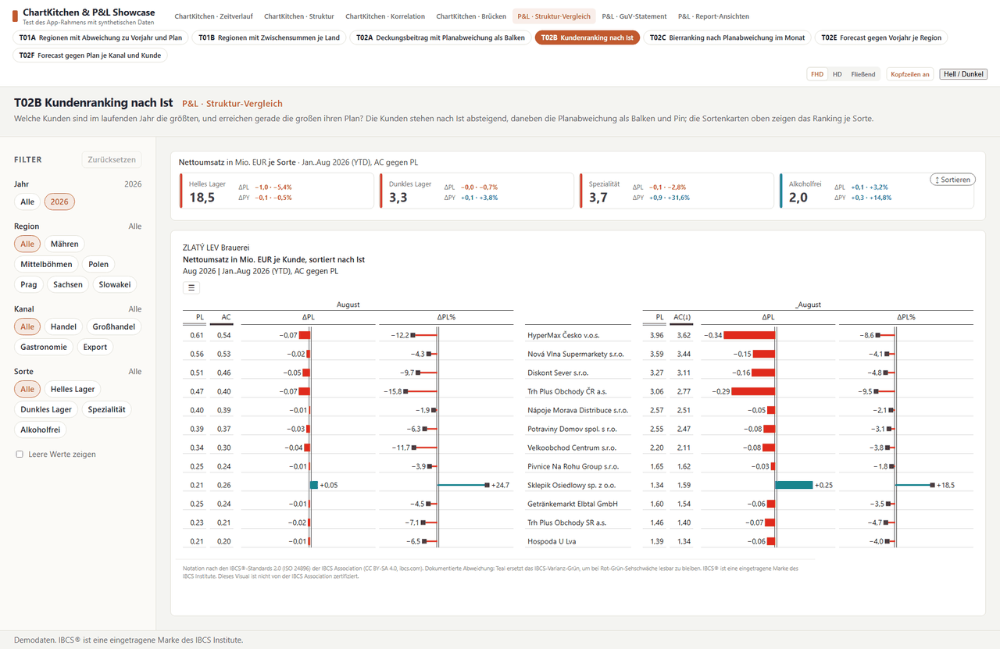
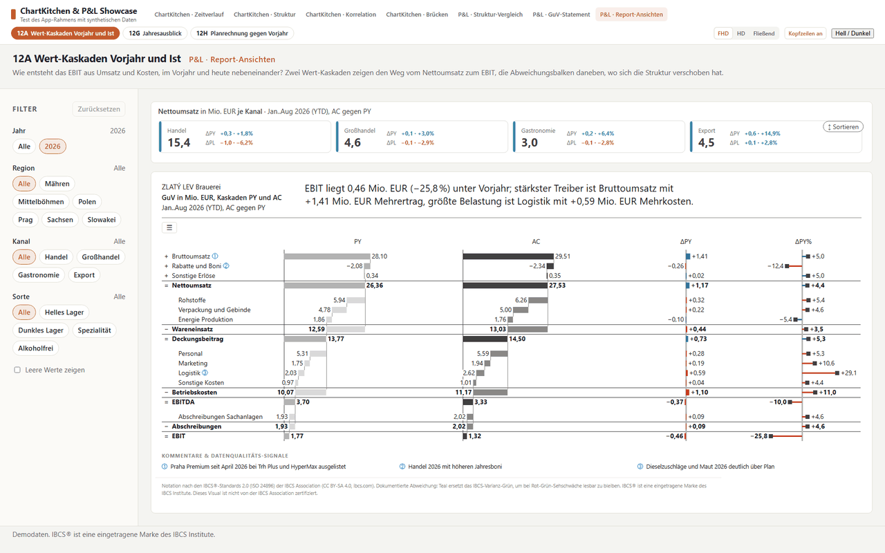
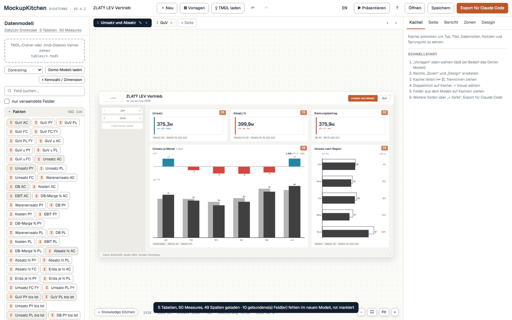
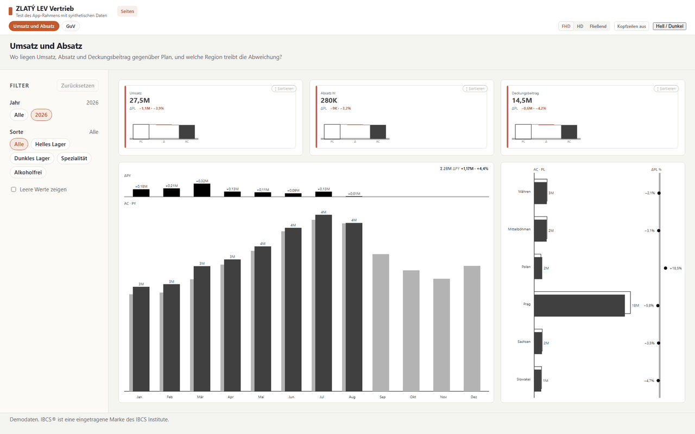
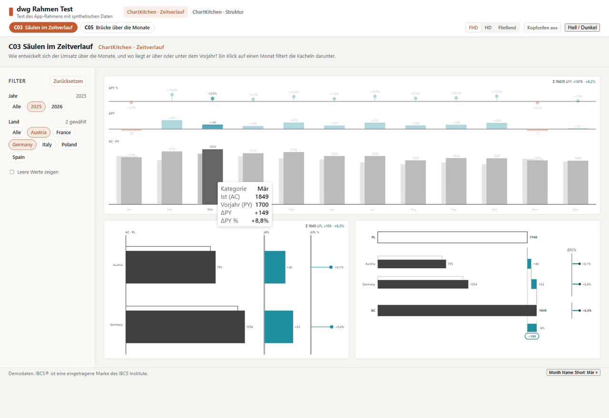
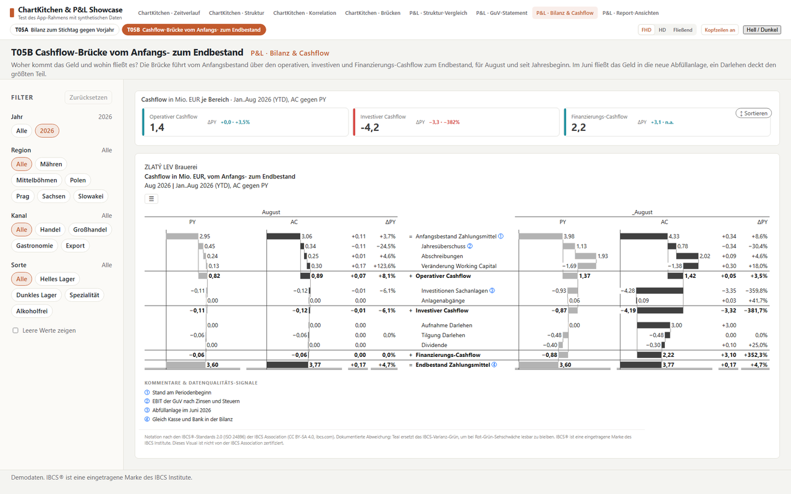

# dwg cli

**One app spec, two targets:** describe report pages once in a JSON spec and get

- a **Fabric App** page (Rayfin, React) that renders the original custom visuals **ChartKitchen byDatenWG** and
  **P&L Statement byDatenWG** with live DAX from your semantic model, cross filtering included, and
- the **same report as a Power BI project** (PBIP/PBIR) with the same visuals, the same bindings and the same layout.

`dwg` is a working title. Version **0.1.1**, an early preview, **developed in public**: expect changes, and
feedback is welcome as an issue. Docs in English below; the detailed handbook and the
skill for Claude are in German ([`docs/handbuch.md`](docs/handbuch.md), [`skill/dwg`](skill/dwg/SKILL.md)).



## Why

Finance and controlling teams build the same report twice today: once in Power BI, and again when a page moves into a
Fabric App, an embedded portal or a custom web front end. The two copies drift apart, and nobody can say for sure that
they still show the same numbers.

dwg keeps **one description** of a page (which template, which fields, which layout) and generates both targets from
it, with the **same custom visuals** and the **same DAX semantics**. A parity test renders every tile the way Power BI
hands data to the visual and the way the app does, and fails if they differ. That makes it practical to

- move report pages into Fabric Apps step by step, without rebuilding them and without losing trust in the numbers,
- start from a workshop sketch in MockupKitchen instead of an empty canvas,
- let people and agents (Claude, via the included skill) build pages through the same commands and the same checks,
- keep finance notation consistent (scenarios AC, PY, PL, FC, variances in the same scale), inspired by IBCS.

## How it fits together



| Step | Command | Result |
| --- | --- | --- |
| Pick a template | `dwg templates` | 30 templates (ChartKitchen C01–C13, P&L T01A–12H plus balance sheet T05A and cash flow T05B) with required, recommended and optional data roles |
| Add a tile | `dwg tile add` | a tile from a template in your spec; missing fields are suggested from your model (TMDL) |
| Import a sketch | `dwg mockup import` | a [MockupKitchen](https://datenwgknowledgekitchen.com/mockup-kitchen.html) export becomes a spec |
| Check | `dwg lint` | pixel grid and accessibility (contrast, minimum sizes, titles) |
| Fabric App | `dwg app page` | pages, DAX queries, navigation, filter panel and the visual adapter written into a Rayfin app |
| Power BI | `dwg pbip new · register · pages`, `dwg validate` | a PBIR report with the custom visuals registered, validated against the official schemas |

Everything can be tested **without Fabric**: a small DAX engine (Mini-DAX) answers the generated queries on demo data,
and a browser harness renders the real generated code with the real visuals.

## What comes out

All pictures below are produced by the test suite (`npm test`, `npm run test:showcase`) from the example specs on
synthetic data: real generated app code, real visuals, Mini-DAX instead of Fabric. Customers and products are
fictitious.

| | |
| --- | --- |
|  |  |
| **C03** columns with ΔPY and ΔPY% in the same scale, forecast hatched | **C13** small multiples per channel, one scale |
|  |  |
| **T02B** customer ranking, month and _YTD blocks | **12A** value cascades PY and AC |
|  |  |
| **MockupKitchen** sketch in a workshop … | … and the page `dwg mockup import` builds from it |
|  |  |
| **App frame**: navigation, filter panel, cross filtering by click, Full HD / HD / fluid, light and dark | **T05B** cash-flow bridge (P&L 1.7 stocks): opening balance, flows, closing balance, month and _YTD |

`tile add` explains every choice (CLI messages are German for now):

```text
$ node dwg.mjs tile add --spec app-spec.json --new-page "P&L" --template T04B --model "examples/showcase/ZlatyLev Showcase.SemanticModel"
T04B · GuV mit Δ-Wasserfall → Seite „P&L“, Kachel „t04b“ [27, 123, 1866, 894], Kennzahlen-Stamm „guv“
  levels          Pflicht    'Konto'[L1], 'Konto'[L2]                    Vorschlag
  ac              Pflicht    'Fakten'[GuV AC]                            Vorschlag    auch: 'Fakten'[GuV ± AC], …
  pl              Pflicht    'Fakten'[GuV PL bis Ist]                    Vorschlag    auch: 'Fakten'[GuV PL], …
  account         empfohlen  'Konto'[KontoID]                            Vorschlag
  rowType         empfohlen  'Konto'[RowType]                            Vorschlag
  …
```

It picked „PL bis Ist“ (plan up to the last actual month) on purpose: the template compares actuals year to date, and
the full-year plan would show −30 % on every row.

The same specs as Power BI reports are validated against the PBIR schemas in the tests. Screenshots from Power BI
Desktop and the service will follow.

## The family

dwg is the bridge between three tools of the Daten-WG Knowledge Kitchen. Each one lives in its own place; dwg ships
only the built pieces it needs (visuals, `.pbiviz`, converter, pixel grid) and rebuilds them from the source repo.

| Tool | What | Links |
| --- | --- | --- |
| **MockupKitchen** | sketch report pages in the browser, with your model's fields, export a spec for agents | [open the tool](https://datenwgknowledgekitchen.com/mockup-kitchen.html) |
| **ChartKitchen byDatenWG** | Power BI custom visual: columns, bars, bridges, scatter, cards, small multiples, templates C01–C13 | [docs](https://datenwgknowledgekitchen.com/chartkitchen-doku_en.html) · [download](https://datenwgknowledgekitchen.com/downloads/chartkitchen-byDatenWG-latest.pbiviz) |
| **P&L Statement byDatenWG** | Power BI custom visual: P&L / income statement, balance sheet and cash flow (stocks), variance waterfalls, value driver tree, templates T01A–12H and T05A/T05B | [docs](https://datenwgknowledgekitchen.com/pnl-doku_en.html) |
| Visual sources | source code of both visuals and MockupKitchen | [PowerBI-Kitchen-](https://github.com/Losveratos/PowerBI-Kitchen-) |
| Released visuals | all `.pbiviz` files in one place | [Power-BI-Custom-Visuals-byDatenWG](https://github.com/Losveratos/Power-BI-Custom-Visuals-byDatenWG) |
| **dwg cli** | one spec for Fabric App and Power BI | this repo |

## Requirements

- Node.js 20 or newer (22 recommended), git
- Python 3 for `dwg mockup import` only
- Chromium for the browser tests (the installer fetches it through Playwright)
- To deploy: a Rayfin app and the Rayfin CLI for the Fabric App, Fabric Git integration or the Fabric CLI (`fab`) for
  the report. dwg itself does not deploy.

## Install

```bash
git clone https://github.com/Losveratos/dwg-cli && cd dwg-cli
node install.mjs              # once; later: node dwg.mjs update | doctor
```

The installer checks Node, git and npm, runs `npm ci`, fetches Chromium, copies the Claude skill to
`~/.claude/skills/dwg` and runs a quick self test (`--full-test` runs everything, `--no-skill`, `--no-browser` skip
steps). Optionally `npm link` gives you a global `dwg` command; the examples below use `node dwg.mjs`.

## Quickstart (10 minutes, no Fabric needed)

```bash
# 1 · see the templates
node dwg.mjs templates
node dwg.mjs templates T04B --lang en

# 2 · build a spec from two templates on the example model (synthetic brewery data)
M="examples/showcase/ZlatyLev Showcase.SemanticModel"
node dwg.mjs tile add --spec quickstart/app-spec.json --new-page "Revenue" --template C03 --model "$M" --measure Umsatz
node dwg.mjs tile add --spec quickstart/app-spec.json --new-page "P&L" --template T04B --model "$M"
node dwg.mjs lint --spec quickstart/app-spec.json
node dwg.mjs check --spec quickstart/app-spec.json --model "$M"   # structure, roles and fields, no app and no report needed

# 3 · the same pages as a Power BI project
node dwg.mjs pbip new --out quickstart/Quickstart.Report --name Quickstart --model "$M" \
  --template "examples/showcase/ZlatyLev Showcase.Report"
node dwg.mjs pbip register --report quickstart/Quickstart.Report \
  --pbiviz visuals/pbiviz/chartKitchenByDatenWG.1.53.0.0.pbiviz --pbiviz visuals/pbiviz/pnlByDatenWG.1.7.0.0.pbiviz
node dwg.mjs pbip pages --report quickstart/Quickstart.Report --spec quickstart/app-spec.json
node dwg.mjs validate quickstart/Quickstart.Report

# 4 · into a Fabric App (needs a Rayfin app with a fabric-semanticmodel connector)
node dwg.mjs app page --app <path to your Rayfin app> --spec quickstart/app-spec.json --connector <name> --model "$M"
```

The same steps in PowerShell (Windows):

```powershell
# 1 · see the templates
node dwg.mjs templates
node dwg.mjs templates T04B --lang en

# 2 · build a spec from two templates on the example model (synthetic brewery data)
$M = "examples/showcase/ZlatyLev Showcase.SemanticModel"
node dwg.mjs tile add --spec quickstart/app-spec.json --new-page "Revenue" --template C03 --model $M --measure Umsatz
node dwg.mjs tile add --spec quickstart/app-spec.json --new-page "P&L" --template T04B --model $M
node dwg.mjs lint --spec quickstart/app-spec.json

# 3 · the same pages as a Power BI project
node dwg.mjs pbip new --out quickstart/Quickstart.Report --name Quickstart --model $M `
  --template "examples/showcase/ZlatyLev Showcase.Report"
node dwg.mjs pbip register --report quickstart/Quickstart.Report `
  --pbiviz visuals/pbiviz/chartKitchenByDatenWG.1.53.0.0.pbiviz --pbiviz visuals/pbiviz/pnlByDatenWG.1.7.0.0.pbiviz
node dwg.mjs pbip pages --report quickstart/Quickstart.Report --spec quickstart/app-spec.json
node dwg.mjs validate quickstart/Quickstart.Report

# 4 · into a Fabric App (needs a Rayfin app with a fabric-semanticmodel connector)
node dwg.mjs app page --app <path to your Rayfin app> --spec quickstart/app-spec.json --connector <name> --model $M
```

`tile add` prints which field it chose for each role, where it came from and the alternatives. If a suggestion is not
clear (several measure families, a structure axis), it stops and lists candidates instead of guessing; pass
`--measure <stem>` or `--<role> <field>` (`'Table'[Column]`, `Table.Column` or a unique name).

## Commands

| Command | |
| --- | --- |
| `install`, `update`, `doctor` | set up, update (`git pull`), check (incl. visual versions: adapter, `.pbiviz`, example reports, published) |
| `visuals build [--kitchen <path>]` | rebuild the visual adapter and the template catalog from the visual sources (Kitchen repo) |
| `visuals update [--kitchen <clone>] [--ref origin/main] [--dry-run] [--commit]` | bring a new visual release into this repo in one step: checkout under `.kitchen/`, adapter, `.pbiviz`, example reports, docs, CHANGELOG, `npm test` |
| `templates [<ID>] [--visual chartkitchen\|pnl] [--lang en] [--json]` | template catalog |
| `tile add --spec … (--page … \| --new-page … [--description …]) --template <ID> [--model …] [--measure …] [--<role> …] [--title …] [--rect x,y,w,h] [--dry-run]` | add a tile from a template; `--title` is the title line inside the visual |
| `app page --app … --spec … --connector … [--model …]` | write the pages into a Rayfin app |
| `pbip new`, `pbip register`, `pbip pages` | create a PBIP report, register the `.pbiviz`, write the pages |
| `validate [<X.Report>]` | validate a report against the PBIR schemas |
| `lint --spec … [--strict] [--json]` | pixel grid and accessibility |
| `check --spec … [--model …] [--json]` | check a spec without an app or a report: structure, filters, roles and bindings per tile, with `--model` also the fields; exit 1 on problems |
| `mockup build`, `mockup import --in … --out …` | MockupKitchen building blocks and import |

Run `node dwg.mjs` for the full help.

## The spec

```json
{ "id": "revenue", "visual": "chartkitchen", "rect": [327, 123, 1566, 894],
  "bindings": { "category": "'Kalender'[Monatsname]", "actual": "'Fakten'[Umsatz AC]", "previousYear": "'Fakten'[Umsatz PY]" },
  "sortBy": { "'Kalender'[Monatsname]": "'Kalender'[Monat]" },
  "objects": { "chart": { "template": "C03", "orientation": "columns", "comparisonMode": "py" } } }
```

`bindings` map data roles to model fields, `objects` are the format pane settings exactly as in Power BI, `rect` is
the position on a 1920 × 1080 page. On top: `slicers` (filter panel), `resolution`, page `group`, `template` and
`description`. Full reference (German): [`skill/dwg/references/app-spec.md`](skill/dwg/references/app-spec.md).
Measures must be model measures for Power BI; free DAX expressions work in the app only.

## Repository

| Folder | |
| --- | --- |
| `dwg.mjs`, `install.mjs` | CLI entry and installer |
| `visuals/` | adapter `@dwg/visuals` (original ChartKitchen and P&L code outside Power BI, `daxQuery()`), committed `dist/` incl. `templates.json`, matching `.pbiviz` in `visuals/pbiviz/` |
| `templates/` | template catalog, field suggestions, `tile add` |
| `app/` | Fabric App generator and templates (`DwgPage`, `DwgShell`, `DwgVisual`), browser harness, Mini-DAX |
| `pbip/` | PBIP/PBIR generator, schema validation with the PBIR schemas in `pbip/schemas/` (from microsoft/json-schemas, MIT), parity test (Power BI vs. app) |
| `layout/`, `mockup/` | pixel grid and MockupKitchen building blocks (generated from the Kitchen repo, do not edit) |
| `specs/`, `examples/` | example specs, models (TMDL) and reports; the showcase has one page per template |
| `skill/` | Claude skill `dwg` (Claude Code and as `dwg.zip` for Claude Desktop) |
| `docs/` | German handbook |

Everything dwg needs at runtime is in this repo: the built visuals, their `.pbiviz`, the template catalog, the PBIR
schemas, the MockupKitchen converter and the examples. The sources (see [The family](#the-family)) are needed only
to rebuild (`visuals build`, `mockup build`).

### A new visual release

When ChartKitchen or P&L ship a new version, one command brings it in:

```bash
node dwg.mjs visuals update --kitchen <clone of PowerBI-Kitchen->        # default: origin/main after git fetch
node dwg.mjs visuals update --kitchen <clone> --ref v1.53.0 --dry-run    # a tag, and first only the plan
```

It checks the Kitchen state out under `.kitchen/` (a detached git worktree, ignored by git, so chunk hashes do not
depend on where the clone lives), rebuilds the adapter and the template catalog, copies the `.pbiviz` into
`visuals/pbiviz/`, registers them in the example reports, lifts the file names in README, docs and skill, adds a
CHANGELOG line and runs `npm test`. Nothing is committed unless you pass `--commit`. `node dwg.mjs doctor` tells
you when a newer version is published than the adapter has, and when `.pbiviz` or example reports drift from it.

## Tests

```bash
npm test               # adapter, generators, templates, Mini-DAX, app pages and shell in the browser, PBIR schemas, parity
npm run test:showcase  # renders all 30 showcase pages, screenshots in app/test/out/showcase/
npm run test:all       # also rebuilds the adapter from the Kitchen repo
```

## Known limitations (0.1)

- Deploying is manual (`rayfin up`, Fabric Git integration or `fab import`); no `dwg up` yet.
- `tile add` places the first tile on an empty page; further tiles need `--rect`. Format options such as
  `numbers.scaling` or titles are edited in the spec.
- Field suggestions read names from the TMDL: scenarios AC/PY/PL/FC/BM by name, calendar and account columns by name.
  Format strings (percent vs. amount), RLS/OLS roles and scenario semantics beyond names are not read yet.
- The app does not use the model's format strings yet; Power BI does.
- Cross filtering in the app: one selection at a time, per column (TREATAS). No drill-through, no bookmarks.
- CLI output is German, the documentation is English.
- The browser tests run against a mini DAX engine on exported data. The response shape of the Fabric connector is
  assumed, not checked against a live workspace.
- Private custom visuals need the tenant setting for organizational or SDK visuals until they are listed in AppSource.

## Contributing

Issues with a command, the spec you used and what you expected help most. For pull requests: run `npm test`
first; generated files (`visuals/dist/`, `layout/pixelgrid.mjs`, `mockup/vendor/`) come from the Kitchen repo and are
not edited by hand. A guided test in German is in [`TESTEN.md`](TESTEN.md).

## License

MIT, see [LICENSE](LICENSE). The visuals and templates are inspired by IBCS®; IBCS® is a registered trademark of the
IBCS Institute. dwg and the visuals are not certified by the IBCS Association. All numbers in the examples are
synthetic.
