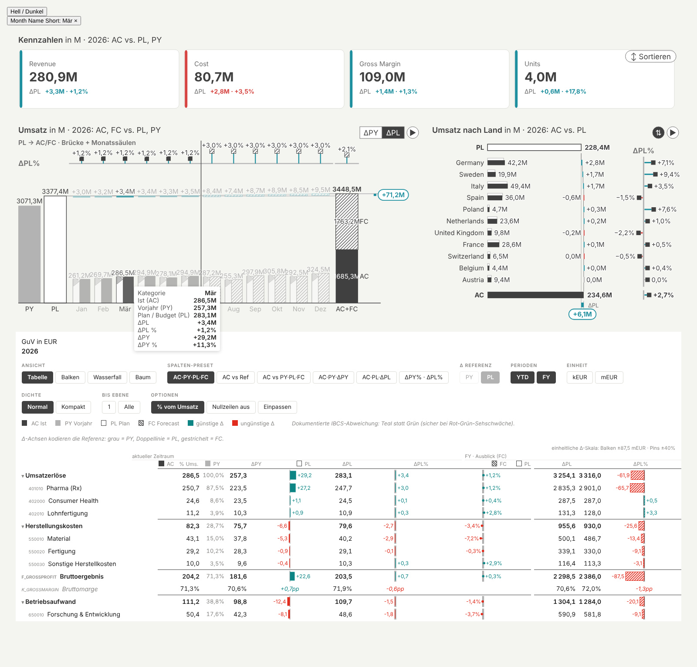

# dwg cli

**One app spec, two targets:** describe report pages once in a JSON spec and get

- a **Fabric App** page (Rayfin, React) that renders the original custom visuals **ChartKitchen byDatenWG** and
  **P&L Statement byDatenWG** with live DAX from your semantic model, cross filtering included, and
- the **same report as a Power BI project** (PBIP/PBIR) with the same visuals, the same bindings and the same layout.

`dwg` is a working title. Version **0.1.0**, private preview. Docs in English below; the detailed handbook and the
skill for Claude are in German ([`docs/handbuch.md`](docs/handbuch.md), [`skill/dwg`](skill/dwg/SKILL.md)).



## What it does

| Step | Command | Result |
| --- | --- | --- |
| Pick a template | `dwg templates` | 28 templates (ChartKitchen C01–C13, P&L T01A–12H) with required, recommended and optional data roles |
| Add a tile | `dwg tile add` | a tile from a template in your spec; missing fields are suggested from your model (TMDL) |
| Import a sketch | `dwg mockup import` | a [MockupKitchen](https://datenwgknowledgekitchen.com/mockup-kitchen.html) export becomes a spec |
| Check | `dwg lint` | pixel grid and accessibility (contrast, minimum sizes, titles) |
| Fabric App | `dwg app page` | pages, DAX queries, navigation, filter panel and the visual adapter written into a Rayfin app |
| Power BI | `dwg pbip new · register · pages`, `dwg validate` | a PBIR report with the custom visuals registered, validated against the official schemas |

Everything can be tested **without Fabric**: a small DAX engine (Mini-DAX) answers the generated queries on demo data,
and a browser harness renders the real generated code with the real visuals.

## Requirements

- Node.js 20 or newer (22 recommended), git
- Python 3 for `dwg mockup import` only
- Chromium for the browser tests (the installer fetches it through Playwright)
- To deploy: a Rayfin app and the Rayfin CLI for the Fabric App, Fabric Git integration or the Fabric CLI (`fab`) for
  the report. dwg itself does not deploy.

## Install

```bash
git clone https://github.com/Losveratos/dwg-cli && cd dwg-cli
node install.mjs              # once; later: node dwg.mjs update | doctor
```

The installer checks Node, git and npm, runs `npm ci`, fetches Chromium, copies the Claude skill to
`~/.claude/skills/dwg` and runs a quick self test (`--full-test` runs everything, `--no-skill`, `--no-browser` skip
steps). Optionally `npm link` gives you a global `dwg` command; the examples below use `node dwg.mjs`.

## Quickstart (10 minutes, no Fabric needed)

```bash
# 1 · see the templates
node dwg.mjs templates
node dwg.mjs templates T04B --lang en

# 2 · build a spec from two templates on the example model (synthetic brewery data)
M="examples/showcase/ZlatyLev Showcase.SemanticModel"
node dwg.mjs tile add --spec quickstart/app-spec.json --new-page "Revenue" --template C03 --model "$M" --measure Umsatz
node dwg.mjs tile add --spec quickstart/app-spec.json --new-page "P&L" --template T04B --model "$M"
node dwg.mjs lint --spec quickstart/app-spec.json

# 3 · the same pages as a Power BI project
node dwg.mjs pbip new --out quickstart/Quickstart.Report --name Quickstart --model "$M" \
  --template "examples/showcase/ZlatyLev Showcase.Report"
node dwg.mjs pbip register --report quickstart/Quickstart.Report \
  --pbiviz visuals/pbiviz/chartKitchenByDatenWG.1.52.3.0.pbiviz --pbiviz visuals/pbiviz/pnlByDatenWG.1.5.3.0.pbiviz
node dwg.mjs pbip pages --report quickstart/Quickstart.Report --spec quickstart/app-spec.json
node dwg.mjs validate quickstart/Quickstart.Report

# 4 · into a Fabric App (needs a Rayfin app with a fabric-semanticmodel connector)
node dwg.mjs app page --app <path to your Rayfin app> --spec quickstart/app-spec.json --connector <name> --model "$M"
```

`tile add` prints which field it chose for each role, where it came from and the alternatives. If a suggestion is not
clear (several measure families, a structure axis), it stops and lists candidates instead of guessing; pass
`--measure <stem>` or `--<role> <field>` (`'Table'[Column]`, `Table.Column` or a unique name).

## Commands

| Command | |
| --- | --- |
| `install`, `update`, `doctor` | set up, update (`git pull`), check |
| `visuals build [--kitchen <path>]` | rebuild the visual adapter and the template catalog from the visual sources (Kitchen repo) |
| `templates [<ID>] [--visual chartkitchen\|pnl] [--lang en] [--json]` | template catalog |
| `tile add --spec … (--page … \| --new-page …) --template <ID> [--model …] [--measure …] [--<role> …] [--rect x,y,w,h] [--dry-run]` | add a tile from a template |
| `app page --app … --spec … --connector … [--model …]` | write the pages into a Rayfin app |
| `pbip new`, `pbip register`, `pbip pages` | create a PBIP report, register the `.pbiviz`, write the pages |
| `validate [<X.Report>]` | validate a report against the PBIR schemas |
| `lint --spec … [--strict] [--json]` | pixel grid and accessibility |
| `mockup build`, `mockup import --in … --out …` | MockupKitchen building blocks and import |

Run `node dwg.mjs` for the full help.

## The spec

```json
{ "id": "revenue", "visual": "chartkitchen", "rect": [327, 123, 1566, 894],
  "bindings": { "category": "'Kalender'[Monatsname]", "actual": "'Fakten'[Umsatz AC]", "previousYear": "'Fakten'[Umsatz PY]" },
  "sortBy": { "'Kalender'[Monatsname]": "'Kalender'[Monat]" },
  "objects": { "chart": { "template": "C03", "orientation": "columns", "comparisonMode": "py" } } }
```

`bindings` map data roles to model fields, `objects` are the format pane settings exactly as in Power BI, `rect` is
the position on a 1920 × 1080 page. On top: `slicers` (filter panel), `resolution`, page `group`, `template` and
`description`. Full reference (German): [`skill/dwg/references/app-spec.md`](skill/dwg/references/app-spec.md).
Measures must be model measures for Power BI; free DAX expressions work in the app only.

## Repository

| Folder | |
| --- | --- |
| `dwg.mjs`, `install.mjs` | CLI entry and installer |
| `visuals/` | adapter `@dwg/visuals` (original ChartKitchen and P&L code outside Power BI, `daxQuery()`), committed `dist/` incl. `templates.json`, matching `.pbiviz` in `visuals/pbiviz/` |
| `templates/` | template catalog, field suggestions, `tile add` |
| `app/` | Fabric App generator and templates (`DwgPage`, `DwgShell`, `DwgVisual`), browser harness, Mini-DAX |
| `pbip/` | PBIP/PBIR generator, schema validation, parity test (Power BI vs. app) |
| `layout/`, `mockup/` | pixel grid and MockupKitchen building blocks (generated from the Kitchen repo, do not edit) |
| `specs/`, `examples/` | example specs, models (TMDL) and reports; the showcase has one page per template |
| `skill/` | Claude skill `dwg` (Claude Code and as `dwg.zip` for Claude Desktop) |
| `docs/` | German handbook |

The visual sources live in [PowerBI-Kitchen-](https://github.com/Losveratos/PowerBI-Kitchen-) (needed only for
`visuals build` and `mockup build`). Released `.pbiviz` files are also in
[Power-BI-Custom-Visuals-byDatenWG](https://github.com/Losveratos/Power-BI-Custom-Visuals-byDatenWG).

## Tests

```bash
npm test               # adapter, generators, templates, Mini-DAX, app pages and shell in the browser, PBIR schemas, parity
npm run test:showcase  # renders all 28 showcase pages, screenshots in app/test/out/showcase/
npm run test:all       # also rebuilds the adapter from the Kitchen repo
```

## Known limitations (0.1)

- Deploying is manual (`rayfin up`, Fabric Git integration or `fab import`); no `dwg up` yet.
- `tile add` places the first tile on an empty page; further tiles need `--rect`. Format options such as
  `numbers.scaling` or titles are edited in the spec.
- Field suggestions read names from the TMDL: scenarios AC/PY/PL/FC/BM by name, calendar and account columns by name.
  Format strings (percent vs. amount), RLS/OLS roles and scenario semantics beyond names are not read yet.
- The app does not use the model's format strings yet; Power BI does.
- Cross filtering in the app: one selection at a time, per column (TREATAS). No drill-through, no bookmarks.
- Private custom visuals need the tenant setting for organizational or SDK visuals until they are listed in AppSource.

Feedback and issues are welcome; see [`TESTEN.md`](TESTEN.md) (German) for a guided test.

## License

MIT, see [LICENSE](LICENSE). The visuals and templates are inspired by IBCS®; IBCS® is a registered trademark of the
IBCS Institute. dwg and the visuals are not certified by the IBCS Association. All numbers in the examples are
synthetic.
