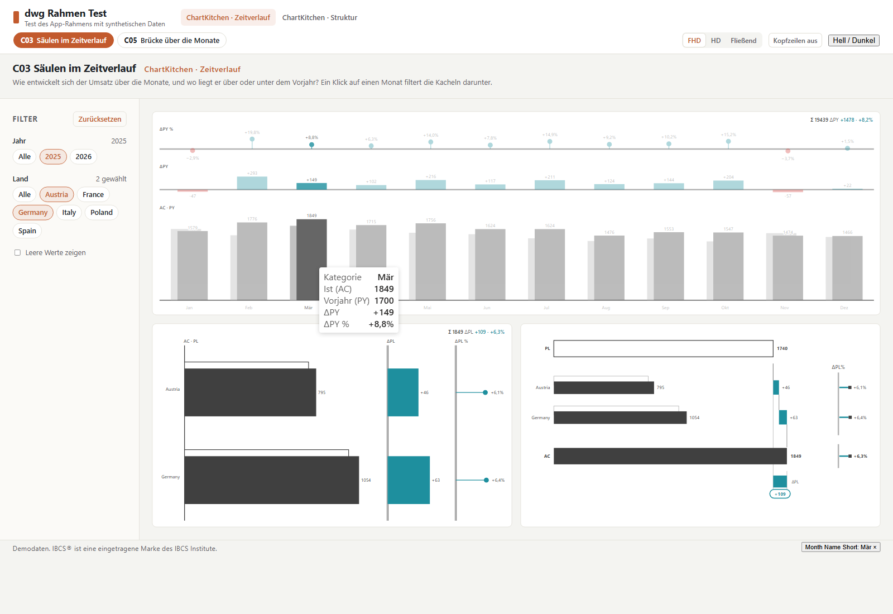
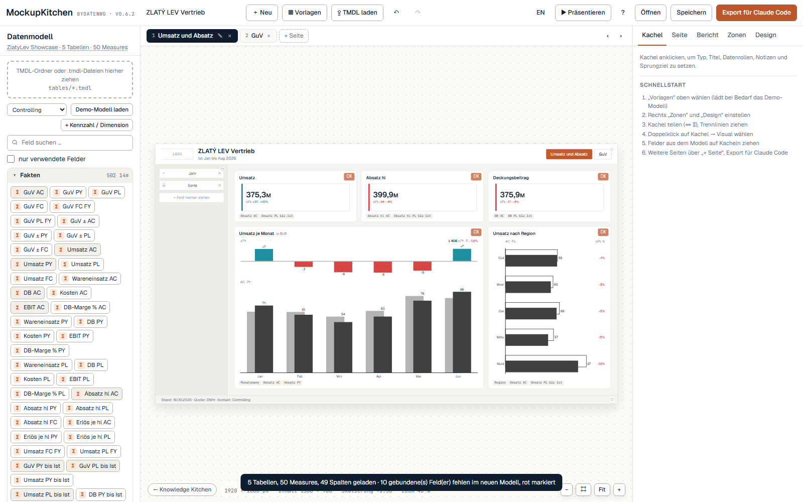

# dwg · Handbuch (deutsch)

Arbeitsname **dwg cli**. Eine App-Spec beschreibt Seiten und Kacheln mit den Kitchen-Visuals (ChartKitchen, P&L
Statement): Datenrollen, Formatbereich-Objekte, Position. Aus derselben Datei entstehen

- eine **Fabric App**: `dwg app page` schreibt die Seite in eine Rayfin-App. Dort rendern die **Original-Visuals**
  über den Adapter `@visuals`, Daten per DAX aus dem Semantikmodell, Querfilter per Klick.
- ein **Power-BI-Bericht** (PBIP/PBIR): `dwg pbip` schreibt Report, Seiten und `visual.json` und trägt die Custom
  Visuals direkt aus der `.pbiviz` ein, ohne Zwischenschritt in Desktop.
- im **Service**: Bericht per Fabric-Git-Integration oder `fab import`, App per `rayfin up`.


## Einrichten

```bash
git clone https://github.com/Losveratos/dwg-cli && cd dwg-cli
node install.mjs            # einmalig; danach: node dwg.mjs update | doctor
```

Der Installer prüft Node, git und npm, installiert die Pakete (`npm ci`), lädt bei Bedarf Chromium für
die Browser-Tests, sucht das Kitchen-Repo (`--clone-kitchen` klont es neben dieses Repo), kopiert den Skill `dwg`
nach `~/.claude/skills/dwg` (alle Claude-Code-Sitzungen, mit dem lokalen Repo-Pfad) und macht einen Selbsttest.
Einen fremden Skill gleichen Namens ersetzt er nur mit `--force`. Für Claude Desktop (Chat) gibt es
`skill/dwg.zip` zum Hochladen.

| Befehl | Was |
| --- | --- |
| `node install.mjs [--full-test]` | einrichten; mit `--full-test` alle Tests inkl. Browser |
| `node dwg.mjs update` | `git pull --ff-only`, dann einrichten |
| `node dwg.mjs doctor` | nur prüfen, nichts ändern |
| `npm test` | alle Tests ohne Kitchen-Repo (nutzt das committete `visuals/dist`) |
| `npm run test:all` | zusätzlich Adapter neu bauen und Adapter-Demo testen (braucht Kitchen-Repo; ändert `visuals/dist`) |

## Aufbau

| Ordner | Inhalt |
| --- | --- |
| [`dwg.mjs`](../dwg.mjs) | einziger Einstieg: `visuals build`, `app page`, `pbip …`, `validate`, `lint`, `mockup build`, `mockup import`, `templates`, `tile add` |
| [`visuals/`](../visuals) | Adapter `@visuals`: ChartKitchen und P&L außerhalb von Power BI, `daxQuery()`. `dist/` ist committet |
| [`app/`](../app) | Generator für Rayfin-Apps und Vorlagen (`DwgPage`, `DwgVisual`, `dwg-page.ts`), Browser-Test mit Mock-Konnektor |
| [`pbip/`](../pbip) | Generator für PBIP/PBIR und Schema-Prüfung |
| [`templates/`](../templates) | Template-Katalog lesen (`dwg templates`), Feldvorschläge aus dem Modell und `dwg tile add`; Katalog `visuals/dist/templates.json` erzeugt `visuals build` |
| [`layout/`](../layout) | `pixelgrid.mjs`: Pixelraster nach MockupKitchen (Zonen, Ränder, Linien, Kacheln, Übertragung zwischen Auflösungen), eine Quelle für Generator, Shell, PBIP, Lint und Import. **Erzeugt** mit `dwg mockup build` aus `assets/mockup/pixelgrid.js` im Kitchen-Repo, das MockupKitchen selbst lädt; Tests gegen die Tabellen des Konzepts (`layout/test.mjs`) |
| [`mockup/`](../mockup) | MockupKitchen-Bausteine: `build.mjs` (holen), `lib/lint.mjs` (`dwg lint`), `lib/import.mjs` (`dwg mockup import`), `vendor/` (geholt, mit Manifest), Beispiel-Mockup und Tests |
| [`skill/`](../skill) | Skill `dwg` für Claude Code (`skill/dwg`) und als Paket für Claude Desktop (`skill/dwg.zip`) |
| [`specs/`](../specs) | Beispiel-Specs: `spike.json` (vier Kacheln), `guv.json` (Statement und Baum), `showcase.json` (jedes Template eine Seite) |
| [`examples/`](../examples) | Modelle und Berichte dazu: „ChartKitchen byDatenWG Demo“ (TMDL), „DWG GuV.Report“, Showcase mit Datenvertrag, Generator, TMDL und Bericht |

## Befehle

Aus dem Repo-Root, einmalig `npm install` (oder `node install.mjs`).

```bash
# Adapter bauen (nur nötig nach einem neuen ChartKitchen- oder P&L-Stand; Kitchen-Klon neben diesem Repo
# oder DWG_KITCHEN=<pfad>)
node dwg.mjs visuals build

# Fabric App: Seite(n) der Spec in eine Rayfin-App schreiben; --model prüft Felder gegen das TMDL
node dwg.mjs app page --app <pfad zur Rayfin-App> --spec specs/spike.json --connector <name> \
  --model "examples/ChartKitchen byDatenWG Demo.SemanticModel"

# Power BI: Report anlegen, Visuals eintragen (oder auf neue Version heben), Seiten erzeugen, prüfen
node dwg.mjs pbip new --out "dwg Spike.Report" --name "dwg Spike" \
  --model "examples/ChartKitchen byDatenWG Demo.SemanticModel" --template "examples/DWG GuV.Report"
node dwg.mjs pbip register --report "dwg Spike.Report" --pbiviz <ChartKitchen.pbiviz> --pbiviz <PnL.pbiviz>
node dwg.mjs pbip pages --report "dwg Spike.Report" --spec specs/spike.json
node dwg.mjs validate "dwg Spike.Report"

# Templates ansehen und eine Kachel aus einem Template anlegen, Felder schlägt dwg aus dem Modell vor (siehe unten)
node dwg.mjs templates
node dwg.mjs tile add --spec specs/neu.json --new-page "Umsatz" --template C03 \
  --model "examples/showcase/ZlatyLev Showcase.SemanticModel" --measure Umsatz

# App-Spec auf Raster und Barrierefreiheit prüfen; MockupKitchen-Export übernehmen (siehe unten)
node dwg.mjs lint --spec specs/showcase.json
node dwg.mjs mockup import --in mockup-spec.json --out specs/neu.json --model "<Y>.SemanticModel"

# alle Tests: Adapter, Generator, Templates, Mini-DAX, App-Seiten und App-Rahmen im Browser, PBIR-Schemas, Parität;
# test:all baut zusätzlich den Adapter aus dem Kitchen-Repo und testet die Adapter-Demo
npm test
npm run test:all
```

## App-Spec

```json
{ "id": "umsatz", "visual": "chartkitchen", "rect": [24, 278, 1140, 560],
  "bindings": { "category": "'Calender'[Month Name Short]", "actual": "'Sales Demo'[AC]", "previousYear": "'Sales Demo'[PY]" },
  "sortBy": { "'Calender'[Month Name Short]": "'Calender'[Month]" },
  "objects": { "chart": { "orientation": "intwaterfall" }, "ibcsTitle": { "kpi": "Umsatz", "period": "2026" } } }
```

| Feld | Fabric App | Power BI |
| --- | --- | --- |
| `bindings` | `daxQuery()` → SUMMARIZECOLUMNS je Kachel | `queryState` mit Column/Measure-Projektionen |
| `objects` | DataView `metadata.objects` | `visual.objects` als Literale |
| `filters` (Seite) | TREATAS in jeder Abfrage | Seitenfilter im Filterbereich |
| `filters` (Kachel) | TREATAS nur in dieser Abfrage | Visual-Filter |
| Klick in einer Kachel | TREATAS für die anderen Kacheln, Filter-Chip | Querfilter von Power BI |
| `sortBy` | ORDER BY | nur Prüfung: „Nach Spalte sortieren" muss im Modell stehen |
| `showItemsWithNoData` | ADDMISSINGITEMS | `showAll` je Gruppierungsrolle |
| `rect` | Position, skaliert auf die Breite; unter 900 px untereinander | Position auf der Seite |
| `slicers` (Spec) | Filter-Panel links (`DwgShell`), TREATAS in jeder Kachel aller Seiten | Slicer im Filter-Panel je Seite, Sync-Gruppe |
| `resolution`, `visualHeaders`, `footer` (Spec) | Seite als Ganzes skaliert, Kopfzeilen der Visuals, Fußleiste | Seite 1920 × 1080, Fußtext |
| `group`, `template`, `description` (Seite) | Navigation oben, „C03 Name“, Erklärtext im Kopf der Seite | Seitenname „C03 Name“, Kopf-Textfeld |

**Regel für beide Ziele:** Kennzahlen sind Modell-Measures (`'Tabelle'[Measure]`). Freie DAX-Ausdrücke gehen nur in
der App; `dwg pbip` lehnt sie ab, `dwg app page --model` lässt sie durch.

## Was `dwg app page` in die App schreibt

Unter `packages/frontend/src/`, bei jedem Lauf ersetzt (nicht von Hand ändern):

- `vendor/dwg-visuals/` — Adapter-Build mit Typen; ChartKitchen und P&L sind eigene Chunks, die erst bei Bedarf laden
- `dwg/DwgPage.tsx`, `dwg/DwgVisual.tsx`, `dwg/dwg-page.ts` (+ Test)
- `dwg/pages/<seite>.ts` (Seiten-Spec) und `dwg/pages/<seite>.dax` (alle Abfragen zum Prüfen in der DAX-Abfrageansicht)
- `dwg/DwgShell.tsx` und `dwg/apps/<spec>.ts` (ganze Spec: Slicer, Seiten in Navigationsreihenfolge), bei Slicern
  `dwg/apps/<spec>.dax` mit den Wertelisten-Abfragen

Eingebunden wird die Seite in der App selbst (`App.tsx` gehört der App):

```tsx
<DwgPage page={page} connection="guv" isDark={isDark} />
// oder alle Seiten der Spec mit Navigation oben und Filter-Panel links:
<DwgShell app={app} connection="showcase" isDark={isDark} actions={<ThemeToggle />} />
```

Voraussetzungen der App: Konnektor vom Typ `fabric-semanticmodel` in `rayfin/rayfin.yml`, Hook
`use-semantic-model-query` (Pack `analytics`).

## App-Rahmen: Filter-Panel, Navigation, Auflösung

Für Apps mit vielen Seiten (Showcase mit allen Templates). In der Spec: `slicers`, `resolution`, `visualHeaders`,
`footer` (oberste Ebene) und je Seite `group`, `template`, `description`; Format und Layout-Vertrag in
`skill/dwg/references/app-spec.md`.

- **Auflösung:** `fullhd` bzw. `hd` baut die Seite in 1920 bzw. 1280 px auf und skaliert sie als Ganzes per
  CSS-Transform: Schriften, Abstände und Visuals bleiben im selben Verhältnis, die Visuals rechnen in Seitenpixeln
  (DwgVisual meldet ihnen die Layoutgröße statt der skalierten). Nie kleiner als 1152 px, dann waagerecht scrollen;
  unter 900 px gestapelt. `responsive` skaliert wie bisher nur die Kacheln. Umschaltbar in der Kopfleiste.
- **Pixelraster wie MockupKitchen** (`layout/pixelgrid.mjs`, Tests `layout/test.mjs` gegen die Tabellen des Konzepts; Konzept im Kitchen-Repo
  `assets/mockup/KONZEPT-PIXELRASTER.md`): Kopf, Filter-Panel links, Fußleiste, Inhalt; bei Full HD Rand 27,
  Zwischenraum 18, 12er-Raster, Inhalt x 327 bis 1893, y 123 bis 1017. Generator, Shell und PBIP rechnen mit demselben
  Modul; die App bekommt es als `src/vendor/dwg-pixelgrid/`. Im HD-Modus überträgt die Shell die Kacheln über das Raster
  (`stagePage`, `transfer`), also pixelgenau mit Zwischenraum 12 statt mit 2/3 skaliert.
- **App (`DwgShell`):** Kopfleiste bleibt beim Scrollen stehen (Gruppen, Seiten mit Template-Kennung, Link `#c03`,
  Schalter Auflösung und Kopfzeilen). Die Seite selbst trägt Titel und Erklärtext im Kopf, das Filter-Panel (Werte per
  DAX, Einfach- und Mehrfachauswahl, Zurücksetzen, leere Werte ausgeblendet, „Leere Werte zeigen“) und den Fußtext.
  Slicer wirken per TREATAS auf alle Kacheln aller Seiten, zusammen mit dem Querfilter per Klick (gleiche Spalte:
  Schnittmenge). Eine Abfrage je Kachel; Filterwechsel fragt die Kacheln der Seite neu ab, Seitenwechsel nur die neue
  Seite; Theme, Fenstergröße, Auflösung und Kopfzeilen lösen keine Abfrage aus (ein Elementbaum für alle Modi).
- **Kopfzeilen der Visuals:** Standard aus (`visualHeaders: false`), Schalter in der Kopfleiste. Setzt zur Laufzeit
  ChartKitchen `ibcsTitle.show`, `chart.chartButtons`, `chart.cumulativeButton` und P&L `titleBlock.show`,
  `toolbar.show` auf aus. Den Sortier-Chip der ChartKitchen-Karten blendet keine Property aus (hängt an der
  Interaktivität).
- **Power BI:** Seitenname „C03 Säulen im Zeitverlauf“, im Kopf ein Textfeld (Titel, Gruppe, Erklärtext), im Filter-Panel
  je Slicer ein nativer Slicer (Dropdown, Startauswahl, Sync-Gruppe je Spalte, Filter „ist nicht leer“), Fußtext,
  Kacheln auf denselben Rechtecken. Wiederholte Läufe behalten die Seiten-IDs.
- **Tests:** `app/test/unit.mjs` (App-Datei, Zonen, Layout-Vertrag, Pixelraster, Slicer-Prüfung), `pbip/test/unit.mjs`
  (Kopf, Fuß, Slicer-Stapel, Sync-Gruppen, „nicht leer“, gleiche Rechtecke, Schemas), Vitest in der App
  (`dwg-page.spec.ts`), Browser-Test `app/test/shell.mjs` (43 Prüfungen: Bühne, Seitenpixel, HD, Fließend, sticky
  Kopf, Mindestfaktor, Kopfzeilen ohne Abfrage, leere Werte, Querfilter, Dark Mode, schmal).



## MockupKitchen-Bausteine: Raster, Prüfung, Import

Was im Workshop mit MockupKitchen skizziert wird, kommt ohne Nachbau in dwg an. Die gemeinsamen Teile liegen **einmal**
im Kitchen-Repo (`assets/mockup/`, Skill `mockup-to-powerbi`) und werden mit `dwg mockup build` geholt, wie die Visuals
mit `dwg visuals build`. Nicht von Hand ändern: im Kitchen-Repo ändern, dann neu holen; `mockup/vendor/manifest.json`
hält die Hashes, `npm test` meldet jede Abweichung.

| Baustein | Quelle im Kitchen-Repo | in dwg | genutzt von |
| --- | --- | --- | --- |
| Pixelraster | `assets/mockup/pixelgrid.js` + `.d.ts` | `layout/pixelgrid.mjs` (ES-Modul, erzeugt) + `.d.ts` | Generator, Shell (App), PBIP, Lint, Import; MockupKitchen im Browser |
| Rasterprüfung | `assets/mockup/gridcheck.js` | `mockup/vendor/gridcheck.js` | `dwg lint` |
| Barrierefreiheit | `assets/mockup/a11y.js` | `mockup/vendor/a11y.js` | `dwg lint` |
| Zuordnung Mockup → ChartKitchen/P&L | Skill `mockup-to-powerbi/scripts/mockup_to_pbir.py` | `mockup/vendor/skill/` | `dwg mockup import` (Python 3) |

**Warum die Quelle im Kitchen-Repo liegt:** MockupKitchen ist ein Browser-Tool ohne Build und lädt `pixelgrid.js` per
`<script>` (`window.MK_PIXELGRID`); es kann nichts aus diesem Repo holen. dwg dagegen baut ohnehin aus dem Kitchen-Repo.
Das ES-Modul `layout/pixelgrid.mjs` ist der unveränderte Quelltext plus Export-Zeilen, die API ist die der ersten
dwg-Fassung aus der Showcase-Runde (die sieben Tests in `layout/test.mjs` laufen unverändert).

```bash
# gemeinsame Teile holen (Kitchen-Klon: --kitchen, DWG_KITCHEN, Klon neben diesem Repo oder Pfad aus install.mjs)
node dwg.mjs mockup build [--kitchen <pfad>]
node dwg.mjs mockup build --check          # weicht etwas vom Kitchen-Repo ab? ohne Kitchen: gegen das Manifest

# App-Spec prüfen: Raster und Barrierefreiheit (Exit 1 bei Fehlern, mit --strict auch bei Warnungen)
node dwg.mjs lint --spec specs/showcase.json [--json]

# MockupKitchen-Export (mockup-spec.json) in eine App-Spec übersetzen, mit Modellprüfung
node dwg.mjs mockup import --in mockup-spec.json --out specs/vertrieb.json \
  --model "examples/showcase/ZlatyLev Showcase.SemanticModel"
```

**`dwg lint`** prüft je Seite:
- *Raster* (bei Specs mit App-Rahmen): Kante 1 bis 3 px neben einer Rasterlinie (mit Vorschlag für `rect`), äußere Kanten
  knapp nicht bündig mit dem Inhaltsrand, Kachel außerhalb des Inhalts (Kopf, Filter-Panel, Fuß). Freie Linien wie 1/5
  sind erlaubt. Ohne Rahmen: fast bündige Kanten und uneinheitliche Zwischenräume. Immer: Überlappungen.
- *Barrierefreiheit* (Regeln aus MockupKitchen): Mindestgröße der Kacheln (Fehler unter 100k × 60k px, Warnung unter
  160k × 90k), Kachel ohne Titel, mehr als neun Kacheln, Schrift zu klein für die Seitenbreite, Slicer ohne Namen, Kontrast
  der App-Farben hell und dunkel. Die Farben liest der Lint aus `app/templates/DwgShell.tsx` (`palette()`), es gibt keine
  zweite Farbtabelle.
- Gleiche Befunde auf vielen Seiten stehen einmal mit Seitenliste.

Stand der Beispiel-Specs: ohne Fehler. Showcase: die Kartenzeile (2/12, 1566 × 134 px) liegt 1 px unter der
Warnschwelle für die Höhe (135 px bei Full HD). Alle Apps: weiße Schrift auf dem Akzent #C25A2D hat 4,4:1 statt 4,5:1
(aktive Seite, gewählte Slicer-Werte).

**`dwg mockup import`** liest `mockup-spec.json` (specVersion 3) und lässt den Konverter des Skills laufen; dwg übernimmt
dessen Ergebnis je Kachel, statt die Zuordnung nachzubauen:

| Mockup | dwg |
| --- | --- |
| Seite, Fragestellung | Seite, `description` |
| Filterbereich mit Feldern | `slicers` (Startwert, Mehrfachauswahl bei Liste/Kachel; mit `--model` Datentyp und Sortierspalte) |
| ChartKitchen-Kachel | `chartkitchen` mit Rollen und Formatbereich aus `chartkitchen-slots.json` (Szenario aus dem Feldnamen, Modus, Top-N, Polarität); ohne Hell/Dunkel und Schriftgrößen, die setzt die App |
| KPI-Kachel | in Power BI `ibcsKpiCard`, in dwg ChartKitchen-Karte (`cards`), Hinweis |
| GuV-Kachel (P&L) | `pnl` mit den Buckets aus `custom-visuals.json`; mit Zeilentyp `showItemsWithNoData` |
| Lage | im Pixelraster: mit Rastermodus im Mockup exakt über die Brüche (`visuals[].cell`), sonst über die Lage im Inhalt, auf 1/24 gerundet (Hinweis bei mehr als 3 px) |
| Sortierung nach Spalte (Modell) | `sortBy` je Kachel |
| natives Visual, Text, Gantt, Deneb, Sprungziele | nicht abbildbar: Hinweis mit Seite, Titel und Text |
| Warnungen des Mockup-Exports | Hinweis |

Danach prüft der Import mit `checkSpec` (Layout-Vertrag) und zeigt die Lint-Zusammenfassung; weiter mit `dwg app page`
und `dwg pbip pages` wie bei jeder Spec. Beispiel und Test: `mockup/test/beispiel/mockup-spec.json` (in MockupKitchen
auf „ZlatyLev Showcase“ gebaut, zwei Seiten, Pixelraster an, Bild `mockup/docs/beispiel-mockup.png`),
`mockup/test/unit.mjs` (13 Tests: Manifest, Lint, Import bis zum schemagültigen Bericht). Ohne Python überspringt der
Test den Import mit Meldung.



**Offen:** In MockupKitchen fehlt Stufe 2 des Pixelraster-Konzepts (Einrasten beim Ziehen, „Pixelgenau machen“ mit
Gewichten aus den sichtbaren Pixeln); der Skill wertet `canvas.pixel` noch nicht aus (Toleranz 0, `--resnap`). Text-
Kacheln und native Karten haben in dwg kein Gegenstück.

## Templates und Kacheln aus der Kommandozeile

Die 28 Templates (ChartKitchen C01–C13, P&L T01A–12H) stehen als Katalog in `visuals/dist/templates.json`. Ihn erzeugt
`dwg visuals build` aus dem Code der Visuals ([`visuals/templates.mjs`](visuals/templates.mjs)): die Schalter, die ein
Template beim Anwenden setzt (ChartKitchen `CHART_TEMPLATES`, P&L `templateSwitches()`), Gruppe, Titel und Zweck in DE
und EN aus den Sprachressourcen, dazu die Datenrollen als Pflicht, empfohlen oder optional. Die Rollen leitet dwg aus den
Schaltern ab (Vergleich mit dem Vorjahr → PY Pflicht, zweiter Block → Periode empfohlen, GuV-Statement → Kontologik
empfohlen); geprüft gegen die abgenommenen Showcase-Kacheln. Derselbe Katalog ist für MockupKitchen gedacht.

```bash
node dwg.mjs templates                 # Übersicht nach Zweck, mit Pflichtrollen
node dwg.mjs templates T04B --lang en  # ein Template: Rollen, was es im Visual einstellt
node dwg.mjs templates --json          # Katalog für Werkzeuge

# Kachel anlegen: --page nimmt eine vorhandene Seite, --new-page legt eine an (neue Spec mit App-Rahmen in Full HD)
node dwg.mjs tile add --spec specs/neu.json --new-page "GuV" --template T04B --model "<Y>.SemanticModel"
node dwg.mjs tile add --spec specs/neu.json --page umsatz --template C04 --model "<Y>.SemanticModel" \
  --measure Umsatz --category Kunde.Region --rect 327,700,780,300 --dry-run
```

Felder: `--<rolle> <feld>` setzt eine Rolle (`'Kunde'[Region]`, `Kunde.Region`, ein eindeutiger Spalten- oder
Measure-Name; mehrere Ebenen mit Komma oder mehrfach `--levels`). Was fehlt, schlägt dwg aus dem TMDL vor:

- **Kennzahlen** über den Stamm: „Umsatz AC“ → Stamm „umsatz“, Szenario AC; PY, PL, FC derselben Kachel kommen aus
  demselben Stamm. Den Stamm gibt `--measure` vor, eine gesetzte Ist-Kennzahl oder das Modell, wenn es nur eine Familie
  gibt (bei GuV-Templates die GuV-Familie mit den meisten Szenarien). Abweichungs-Measures (Δ, Abw.) fallen weg,
  Varianten (YTD, R12, FC2, ±) bleiben Alternativen. Vergleicht ein P&L-Template Ist über das laufende Jahr ohne
  Periodenfeld, nimmt dwg „PY/PL bis Ist“, damit Ist und Plan dieselben Monate zeigen.
- **Spalten**: Zeitachse aus der Kalendertabelle (Monatsname mit Sortierspalte), Ebenen L1..Ln und die GuV-Logik
  (Zeilentyp, Formel, Vorzeichen, Umkehr, Sortierung, Konto) aus derselben Tabelle. Strukturachsen (Region, Kanal, Kunde)
  und die Ebenen der Strukturtabellen T01/T02 gibt man an; dwg nennt Kandidaten.

Übernommen wird ein Vorschlag nur, wenn er eindeutig vorn liegt; sonst bricht `tile add` ab und nennt Kandidaten. Die
Kachel bekommt die Schalter des Templates, Sortierspalte und Anzeigenamen (ChartKitchen), den Template-Titel und auf
einer leeren Seite den ganzen Inhaltsbereich; daneben braucht sie `--rect`. Danach gelten `checkSpec`, `dwg lint`,
`app page` und `pbip pages` wie für jede Spec.

Tests: `templates/test/unit.mjs` (17: Katalog, Schalter und Pflichtrollen gegen die 28 Showcase-Kacheln, Vorschläge
treffen deren Felder, Kurzangaben, Kommandozeile). Von Hand geprüft: drei Seiten aus `tile add` (C03, T04B, T01A) als
schemagültiger Bericht (`pbip pages`, `validate`) und im Browser-Testrahmen gerendert, Zahlen wie die Showcase-Seiten;
Gegenprobe auf dem Modell „ChartKitchen byDatenWG Demo“ (L1..L6, Measures ohne Stamm).

**Offen:** Lage neben vorhandenen Kacheln automatisch (heute `--rect`), Format-Vorgaben wie `numbers.scaling` per
Option, MockupKitchen liest den Katalog (Template-Auswahl je Kachel, Rollen-Checkliste).

## Beispiel GuV

Spec [`specs/guv.json`](../specs/guv.json) auf dem Modell „ChartKitchen byDatenWG Demo“, Bericht
`examples/DWG GuV.Report`. Zwei Seiten mit dem P&L Statement: GuV-Statement und GuV-Baum, Jan bis Aug 2026 mit
FY-Ausblick. Getestet mit den CSV-Quellen des Modells (5.000 Konten): `app/test/guv.mjs` (Kontrollwerte),
`app/test/e2e.mjs --page guv-statement|guv-baum`.

- `tiles[].filters` (Kachelfilter; App TREATAS, Power BI Visual-Filter).
- Keine Monatsspalten: 5.000 Konten × 12 Monate sprengen die executeQuery-Grenzen.

## Stand und Grenzen

- **Geprüft (npm test):** Adapter, Generator, Templates und Feldvorschläge, Mini-DAX gegen Kontrollwerte, App-Seiten
  und App-Rahmen im Browser mit Mock-Konnektor (Rendern, eine Abfrage je Kachel, Querfilter mit TREATAS, Dark Mode,
  schmal, keine Konsolenfehler), PBIR gegen die offiziellen Schemas, Parität Power BI gegen App.
- **Nicht geprüft:** echte Abfragen gegen das Semantikmodell in Fabric und die Anmeldung (braucht Fabric-SSO), der
  Bericht in Desktop/Service. Das macht ein Mensch.
- Querfilter in der App: eine Auswahl gleichzeitig, Filter je Spalte (TREATAS). Kein Drill-through, keine Lesezeichen.
- Private Visuals im Bericht brauchen im Tenant die Einstellung für SDK-Visuals (bis zum AppSource-Listing).

Alle Zahlen im Demo-Modell sind Demodaten. IBCS® ist eine eingetragene Marke des IBCS Institute.
